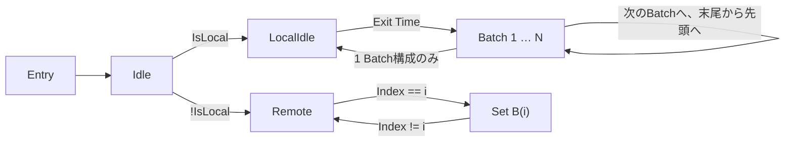

# Parameter Compression

## 使用方法

1. Avatar Rootへ `VRC Avatar LiteKit Plus/Parameter Compressor` Componentを追加します。追加時から有効で、Inspectorの設定またはComponentの削除で無効化できます。
2. Inspectorで同期チャンネル数、圧縮前後の総同期使用量、対象・除外理由、生成予定の同期Parameter・FXレイヤーを確認します。
3. OSCや外部連携で直接同期が必要なParameterを手動除外し、通常どおりBuildします。

Inspectorは現在のExpression Parameters・FX・Avatar階層から推定します。NDMFの前段で構成が変わる場合があるため、Build cloneの再検証を最終判定とします。

## 同期方式

元のExpression Parameters順を型別に保ち、FloatのBatch、IntのBatchの順に割り当てます。各Batchの幅は最大K、Indexは1〜255、0は初期値です。元のParameter名・型・saved・defaultValue・順序を保持し、対象のnetworkSyncedだけをfalseにします。共有チャンネルとIndexは末尾へ追加し、同期有効、保存なし、初期値0にします。

対象がFloat 5個、K=1なら、40bitが16bitになります。全体の同期コストは非対象も含めてSDKの計算を使います。非標準の同期精度で設定されたFloat・Intは、8bitの共有チャンネルへ移さず除外します。削減効果が出る範囲へKを制限します。

```text
対象の圧縮後コスト = 8 + 8 × min(K, Float数) + 8 × min(K, Int数)
```



FXレイヤーは1本、重み1で、3 + 2 × Batch数のStateを持ちます。Entryは既定のIdleへ進み、Any State・Exitへの遷移やBlend Treeは生成しません。LocalのEncoderはlocalOnlyのParameter Driverで元値を同型チャンネルへCopyし、最後にIndexをSetします。RemoteのDecoderはIndexを条件にStateへ入り、対応する元Parameterへ逆方向にCopyします。Localの保持は0.1秒のタイミングClipとExit Timeで制御します。

型をまたぐ変換、独自の量子化、補間は行いません。ネットワーク上のFloat精度とInt範囲はVRChatの同期仕様に従います。ローカルのDriver実行順だけでは、IndexとChannelの同時到着や、RemoteがすべてのBatchを受信することは保証できません。Indexが変わらなければDecoderのState再入場が起きず、同一Indexの値更新を適用できない場合があります。有効な削減案は少なくとも2 Batchを必要とします。連続更新が重要なParameterは除外し、PC・Android・iOS間で同期するアバターでは対象順とKを揃えます。

## 除外とビルド停止

自動選択の対象は直接同期するFloat・Intです。Bool、Trigger、非同期、既知のVRChat Built-in、Unified Expressions v2、Contact ReceiverのParameter、非標準の同期精度、既知の他ツール内部名を除外します。MenuBuilder、LightLimitChanger、VRCFury、参考ツールの同期名は既知の名前から検出します。手動除外を解除しても自動除外は維持されます。savedは圧縮可能で、保存設定を保持します。OSCや任意の外部システムの利用、MAやVRCFuryが生成する全Parameterの由来は一般には判定できません。カスタム補間など直接同期に固有の設定が必要な場合も手動で除外します。由来が不明なParameterは既知の除外規則と手動設定で扱います。

有効なComponentでは次の条件を生成前に検査し、該当時はNDMFのビルドエラーにします。

- Expression Parameters、参照するメニュー、Contact Receiver、PlayablesのAnimator Controllerが予約Parameter名 `LiteKit_PC_*` を使用している。
- Playablesに生成予定の名前と同じAnimator Layerがある。
- 圧縮対象または `IsLocal` の型が一致しない、または同じ入力Asset内でこれらが重複している。
- 生成に必要なカスタムFXがない、タイミング用パスが既存オブジェクトに当たる、Batch数が255を超える、または適用後も同期コストが256bitを超える。

対象なし・削減なしの構成では、衝突や必須設定のエラーがなければ生成をスキップします。名前だけで所有権を認定せず、既存のParameterやLayerを削除・置換しません。過去に生成された結果を再入力した場合も、同じ衝突規則を適用します。

変換はNDMFのOptimizing Phaseで実行します。Expression ParametersはUnityの複製でSDK固有のフィールドも保持します。FX Controllerは複製してから新規Layerを追加します。Clip・State・Driver等も新規インスタンスを作り、NDMF AssetSaverへ渡します。表示名が同じAssetをパスで検索して再利用する処理はありません。保存まで成功してから、Build cloneのDescriptor参照を差し替えます。元のPrefab・Controller・Parameter Asset・Clipを直接編集する処理はありません。

Modular Avatarは任意です。参照環境のMAではリネーム・Animator統合がTransformingで行われます。Avatar OptimizerはOptimizingも使うため、同フェーズの順序を保証しません。VRCFuryとの実行順を固定する指定は追加していません。LiteKit自身はVRChat SDKのBuild・Upload APIを呼び出しません。

## Issue #12 の参考実装監査

調査対象は検証環境の `Assets/Harishiroom/ParameterCompressor` にある **VRC Parameter Compressor** です。Assets直下インストールで、Package manifest・ロック・VPM manifestに登録はありません。NDMF QualifiedNameは `com.harishiroom.parameter-compressor` です。UPM Package ID、Version、package.json、ライセンス、配布URLはローカル資料で確認できませんでした。フォルダー、名前空間、ComponentメニューにHarishiroomの表記があります。

`Harishiroom.ParameterCompressor.Runtime.asmdef` はVRC.SDK3AとVRC.SDKBaseを参照し、IEditorOnlyの設定Componentを定義します。`Harishiroom.ParameterCompressor.Editor.asmdef` はEditor限定で、Runtime、NDMFとNDMF VRChat連携、SDK3A・SDKBaseと各Editor assembly、Modular Avatar coreを参照します。MAスキャナーには `PC_HAS_MODULAR_AVATAR` の条件があります。EditorはBuild、Generator、Validation、Scanner、Inspectorに分かれています。

| 項目 | 参考実装 | LiteKit main | Issue #12 |
|---|---|---|---|
| Float / Int / Bool | 同期Float・Intを型別処理。Bool・非同期・既知の予約名は除外 | 同方式。既知名の識別に一部差 | 同方式を維持。Contact、非標準の同期精度、他の既知の同期名を追加除外 |
| Channel / Index / Encoding | 8bit Int Indexと同型チャンネル。Floatの後にIntをBatch化 | 同方式。Index上限255を検査 | 同じ配線・順序・上限 |
| Network / Driver | LocalでChannel Copy → Index Set。RemoteはIndexのState進入でCopy | 同方式 | 順序を保持。ネットワークの原子性や更新頻度は別途検証 |
| Animator | 単一FX Layer、重み1、3 + 2N State。条件遷移とExit Time、Write Defaultsを明示true。共有空Clip、0.5秒の起動待ち、0.1秒のBatch Clip | 同じ分岐・State数。LocalIdleと各Batchに0.1秒のClip、Remote側はMotion指定なし。Write DefaultsはUnity生成時の挙動 | タイミング・Write Defaultsを維持。タイミングClipの既存オブジェクトへの適用を防止 |
| Expression Parameters | 元Parameterの同期解除後、`PC_Sync_*` を削除・末尾へ再生成。256bitはInspectorで表示 | 元Parameterの属性は保持。LiteKit接頭辞を削除し、予算超過はログのみ | 同期解除と新規追加。既存Parameterを保持し、変換後の予算超過はエラー |
| 衝突 | 接頭辞をInspectorで案内。Animator Parameterは名前で流用、同名Layerを明示チェックせず追加 | 接頭辞や同名Layerを取り除き、既存Animator Parameterは名前で流用 | 予約名・同名Layer・型不一致を変更前に検出し、生成を停止 |
| NDMF・生成物 | Optimizing。入力のExpression Asset・FXを直接編集し、Clip等をControllerのsub-assetに追加 | Optimizing。明示複製・AssetSaver | Phaseと複製方針を維持。生成Objectのみ保存し、参照切り替えを最後に実施 |
| Inspector / Validation | Cost・手動除外・NDMF ProviderやMAを含む複数ソースの推定。対象不足はスキップ、構成エラーを報告 | Cost・手動除外・Expression / FXの推定。失敗分類をメッセージ文面に依存 | 生成予定・除外理由・型と衝突を追加。InspectorとBuildで同じ検証 |

- **KEEP** — Component-first、元Asset保護、Optimizing、型別多重化、Index命名・順序、既存のComponent設定。
- **CHANGE** — 名前による削除・再利用とログ文面による失敗分類を、事前検証と明示エラーへ変更。
- **ADD** — 予約名・同名レイヤー・型・タイミングパス・予算の検証、生成プレビューと除外理由。
- **DO NOT COPY** — 参考実装の接頭辞による置換、入力Assetへの直接変更、広範なMA推定、既存コードと識別子。
- **DEFER** — OSCや任意の外部ツールの自動識別、Force Include、他Pluginとの強制順序、同期プロトコルの変更。既存Componentの公開API、シリアライズフィールド、JSONレポートに変更がないため、今回のSchema移行は不要です。

## Issue #12 の検証

Unity 2022.3.22f1、VRChat SDK 3.10.6、NDMF 1.15.1の一時プロジェクトで、Prefabから作成したクローンに対しNDMFのAvatarProcessorを実行しました。Float、Int、混在、対象なし、1項目、無効、Kの上限、Index 255と超過、256bit予算超過、既存予約名（同型・異型を含む）、対象・IsLocalの型不一致、同名Layer、タイミングパス、Expression重複、Contact、カスタムビット幅を検証しました。混在ケースでは同じPrefabから2回処理し、生成Layerが各クローンに1本だけであることを確認しました。元Prefab・FX・Expression Parametersのファイル内容と、元FX・Expression Parametersの読み込み済みデータを照合しました。各BatchのEncoder・DecoderのCopy対応と、EncoderでIndexのSetが最後であることも確認しました。

VRChat SDK Builderを通したBuild、VRChat実機上の同期、PC・Android・iOS間の受信、他の最適化Pluginと併用したBuild、宣言下限Versionでの実Buildは未検証です。
